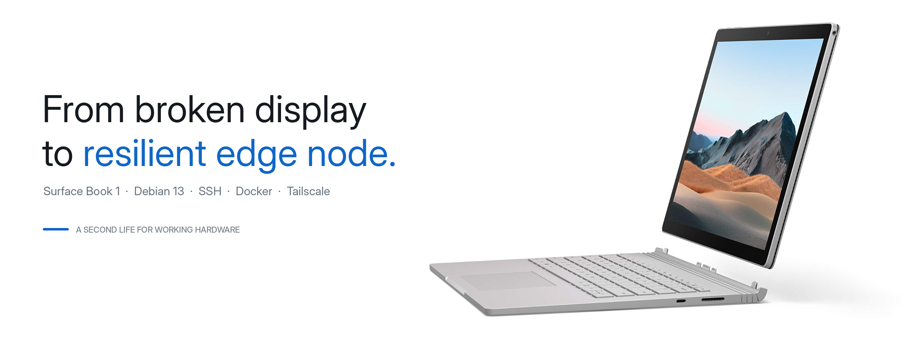
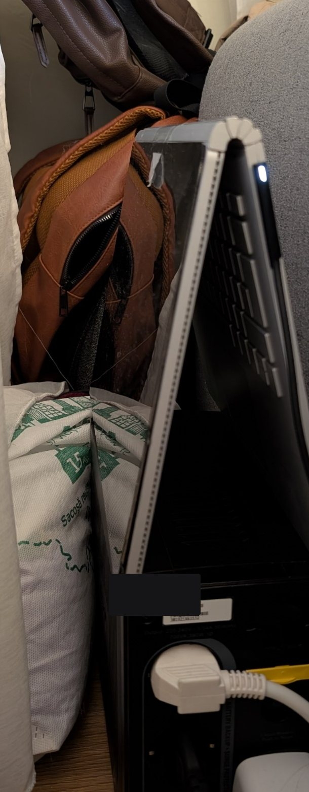
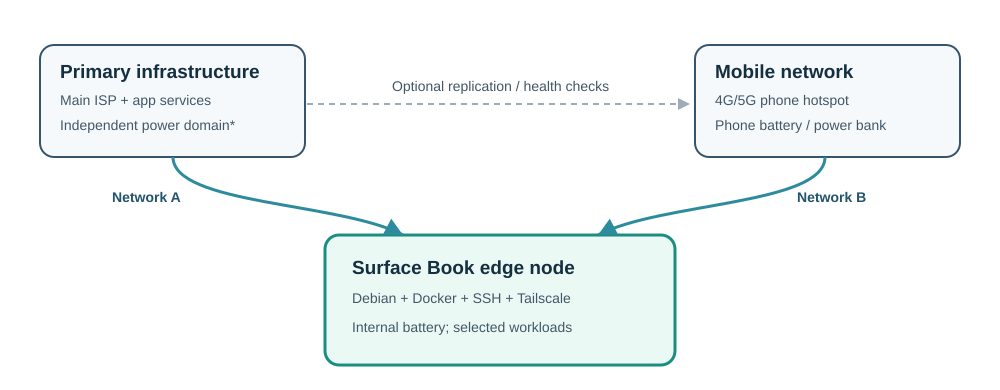
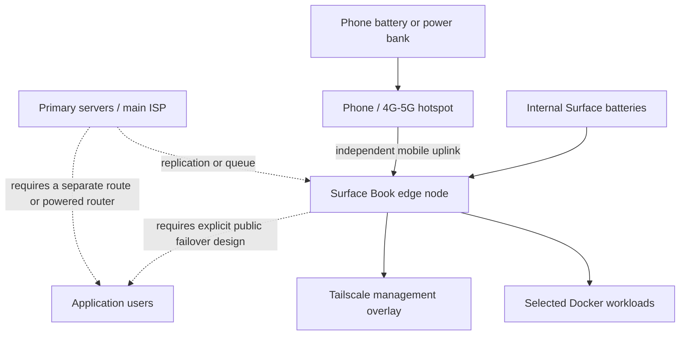

<p align="center">
  
</p>

<h1 align="center">Recycling a First-Generation Surface Book into a Resilient Linux Server</h1>

<p align="center"><strong>Giving aging hardware a second life as a headless, battery-backed edge node with an independent mobile-internet option.</strong></p>

<p align="center">
<a href="https://www.microsoft.com/surface"></a>&nbsp;&nbsp;
<a href="https://www.debian.org/"></a>&nbsp;&nbsp;
<a href="https://www.docker.com/"></a>&nbsp;&nbsp;
<a href="https://tailscale.com/"></a>
</p>

<p align="center">
  
  
  
  
</p>

> [!IMPORTANT]
> **This is a documented field conversion, not a certified high-availability appliance.** The original machine successfully booted Debian 13 from its SSD and was accessed over SSH. Docker, Cockpit, Wi-Fi and a Tailscale daemon were observed running. Independent uplink failover, application replication, total battery runtime and GPU functionality **were not verified as end-to-end services**. The generic public installer is a redacted refactor of the private field build and has not itself been tested on identical hardware.

**New here? Start with the [five-minute quick-start guide](START_HERE.md) — choose macOS or Windows, build, flash, boot, SSH.**

## The idea in 60 seconds

We needed a small computer **outside the primary server infrastructure**, able to use a **different internet connection** and keep running during a local power interruption. Meanwhile, a first-generation Microsoft Surface Book could no longer serve reliably as an everyday laptop because of a **board-level display problem**. The remaining hardware was valuable: Skylake CPU, 8 GB RAM, SSD, Wi-Fi, and at least one usable internal battery.

Instead of treating a failing display as the end of the device's useful life, we installed Debian in **headless mode** and moved all management to SSH. The result is an inexpensive *auxiliary edge node* designed to provide network diversity and potentially host a carefully chosen subset of application services while the primary infrastructure is unavailable.

**It is not magic redundancy:** the mobile carrier, phone, local router, batteries, data replicas and traffic-routing mechanism must each be considered separately. See [Architecture](docs/ARCHITECTURE.md) and [Validation](docs/VALIDATION.md).

<p align="center"></p>
<p align="center"><em>Real project photograph, privacy-cropped. The computer is operated remotely; the damaged display is not used for routine administration.</em></p>

## Project at a glance

| Dimension | Observed prototype | Intended evolution |
|---|---|---|
| Hardware | First-gen Surface Book, Intel Skylake, 8 GB, Toshiba NVMe 256 GB | Repurpose otherwise underused hardware |
| Display | Hardware-level malfunction (board-related) | Zero routine display dependency |
| OS | Debian GNU/Linux 13, headless | Automated reproducible installations |
| Disk | GPT, EFI and ext4 root occupying almost all SSD | Prevent half-used root partitions |
| Remote management | SSH, Avahi `.local`, Cockpit | SSH keys + restricted management access |
| Containers | Docker and Compose available | Selected independent application workers |
| Network | Wi-Fi connected to local network | Mobile hotspot as an independent uplink |
| Power | Internal battery detected, AC adapter detected | Controlled battery shutdown + external hotspot power |
| VPN | `tailscaled` service observed active, user not logged in at report time | Tailscale tailnet enrollment |
| Video | Intel HD 520 detected, NVIDIA physically reported but absent in PCI enumeration | Benchmarked Quick Sync for lightweight media jobs |

## Architecture





> [!WARNING]
> An additional internet connection is **not** itself application failover. A usable secondary path requires connectivity, power, reachable endpoints, health checks, state synchronization, and a deliberate method to route users or jobs. Batteries in the Surface Book do **not** power the phone or the main router.

## The two-stage experience

### Stage A — build and flash a reusable installer (macOS or Windows)

This repository contains a public, credential-free version of the **Debian Installer Preseed + xorriso workflow** used in the project.

1. **macOS:** clone or download the repository, then open `installer/Build_Installer.command`. **Windows:** run `windows/START_WINDOWS.cmd` (requires WSL/Ubuntu; see the [Windows guide](docs/WINDOWS_INSTALLATION.md)). Both paths ask **locally** for a hostname, user, Wi-Fi SSID/password and a Linux account password, verify the Debian download and produce a custom ISO with a separate `SURFACELOG` partition.
2. Flash the *generated* ISO with **balenaEtcher** or **Rufus in DD image mode** (not Rufus ISO extraction mode). Follow the illustrated-in-steps [USB flashing guide](docs/USB_FLASHING.md). **Do not drag files onto an existing boot stick.**
3. Connect the Surface Book to power and, if possible, **USB-Ethernet for the netinst**. Boot from the USB drive; select the clearly labeled `AUTO-INSTALL` menu option.
4. The installer runs unattended after choosing that entry, subject to firmware, networking and package repository availability. The workflow halts at completion; remove the stick and power on the computer again.
5. From your Mac or Windows PC, connect through SSH using the username and hostname chosen during the build.

**"Two Enter presses" describes the field workflow after configuration** (choose the installation entry and confirm), not a universal promise: you still supply your credentials when generating a public-safe ISO, consent to disk erasure and may encounter additional firmware/network prompts on unsupported setups.

> [!CAUTION]
> The `AUTO-INSTALL` entry is **destructive**. It erases the target SSD. The disk guard checks the model and expected size before partitioning. The included default model applies to **one documented Toshiba 256 GB device**, not every Surface Book. Do not disable the guard merely to make installation proceed. Back up all data first.

Detailed directions: **[Installation guide](docs/INSTALLATION.md)**. The real manual installation screens and error evidence are discussed in [Troubleshooting](docs/TROUBLESHOOTING.md).

### Stage B — administer and configure services over SSH

After a successful boot, on macOS Terminal, Windows PowerShell or a Linux terminal:

```bash
ssh <your-user>@<your-hostname>.local
```

For example, with **illustrative** names only:

```bash
ssh surfaceadmin@surfacebook-node.local
```

On first connection, verify the ED25519 fingerprint out-of-band before accepting. For password access, enter the password selected during ISO generation. The terminal displays no password characters while typing.

For reliable administration, use an SSH key, keep Cockpit confined to trusted networks and activate Tailscale interactively after installation. To run the optional Debian post-configuration from macOS, use `bash scripts/Configure_from_Mac.command` (on Windows, use `windows/Postconfigure_from_Windows.ps1`) after a successful first boot. See [SSH & security](docs/SECURITY.md) and [Post-install](docs/POST_INSTALL.md).

<p align="center"></p>
<p align="center"><em>An actual SSH session on the converted Surface Book. macOS account/window metadata has been cropped out.</em></p>

## What actually worked

The field report recorded the following after the installation and post-configuration:

| Signal | Recorded result |
|---|---|
| Root filesystem | ext4, approximately **233 GiB** mounted at `/` |
| Used space | Approximately **4.0 GiB** |
| Available space | Approximately **218 GiB** |
| Swap | **2 GiB** file |
| Network | Wireless interface connected via DHCP |
| SSH / Docker / Cockpit | Services reported active |
| Tailscale | Daemon active, **not yet authenticated** |
| AC adapter | Online |
| Visible internal battery | `BAT2`: **40.455 Wh** full vs **51 Wh** design (approximately **79.3%** reported health) |
| Other internal battery | **Not exposed** in the available Debian power-supply report |
| Intel GPU | HD Graphics 520 / `i915` detected |
| NVIDIA | Physical dGPU in base (per Microsoft specs); **not enumerated by `lspci`** |

The original field output also contained local identifiers and network data; those have deliberately **not** been copied to this repository. See the explicitly labeled [sanitized sample report](examples/sample-status.md).

## Downloads — source vs. releases

The source code itself lives in the repository; users should not have to understand Git to try it. **Once a release is published**, GitHub's **Releases** area can provide two starter bundles:

- **macOS builder ZIP** — double-click the `.command` file, enter local configuration, then flash the resulting ISO using balenaEtcher.
- **Windows builder ZIP** — double-click `windows/START_WINDOWS.cmd`; a ready-to-use WSL Ubuntu/Debian environment is required. The launcher then builds the same Debian installer and saves the ISO to `output/`.

Releases can be generated automatically by the included GitHub Actions workflow when the maintainer pushes a version tag. **This ZIP by itself does not create or publish an actual GitHub Release.** See [Releases & publishing](docs/RELEASES.md) and [Release notes](docs/RELEASE_NOTES.md).

> [!NOTE]
> We intentionally **do not distribute a personalized, pre-built ISO**. Each operator must supply their own Wi-Fi and Linux credentials, so publishing the generated image would be unsafe. What gets released is the *builder*, not a secret-bearing installer.

## Documentation index

| Read | For |
|---|---|
| [00 — Start here](START_HERE.md) | Beginner-friendly platform chooser, six steps, SSH |
| [01 — Why this project exists](docs/MOTIVATION.md) | Hardware reuse, constraints, failure domains, e-waste |
| [02 — Architecture & failure modes](docs/ARCHITECTURE.md) | Separate uplinks, backup power, active/passive roles, RTO/RPO |
| [03 — Install from macOS](docs/INSTALLATION.md) | Generator, EFI, logs, boot, credentials |
| [03b — Install from Windows](docs/WINDOWS_INSTALLATION.md) | WSL prerequisite, one launcher, ISO output |
| [03c — Flash with Etcher / Rufus](docs/USB_FLASHING.md) | Exactly which ISO, USB selection, DD mode |
| [04 — Post-install & operations](docs/POST_INSTALL.md) | Docker, Tailscale, Cockpit, disk, SSH, battery and GPU |
| [05 — Security & privacy](docs/SECURITY.md) | Secrets, SSH hardening, firewall, backups, public repository policy |
| [06 — Troubleshooting](docs/TROUBLESHOOTING.md) | Blue screen, GRUB, checksums, `mkfs.fat`, logger, SSH |
| [07 — Validation & test matrix](docs/VALIDATION.md) | What was tested, what remains unverified |
| [08 — Reproducibility notes](docs/DEVELOPMENT.md) | Version pinning, exact tests, known limitations |
| [09 — Releases](docs/RELEASES.md) | How to generate macOS and Windows downloads and publish prereleases |
| [10 — Field notes](docs/FIELD_NOTES.md) | The installation problems we encountered and what fixed them |
| [11 — Quality assurance](docs/QUALITY_ASSURANCE.md) | Actual tests, limitations and prerelease acceptance criteria |

## Key project principles

**1. Reuse before replacement.** A faulty display need not imply an unusable computer. Reuse reduces unnecessary electronics disposal but does not eliminate risks of aged batteries.

**2. Separate failure domains.** Two servers on one ISP or one power strip do not provide meaningful independence. Network diversity and power autonomy are separate design dimensions.

**3. Headless by default.** SSH eliminates reliance on the damaged local screen after boot. A fallback recovery channel is still necessary for boot failures.

**4. Automate reproducibly, but fail closed.** Prefer documented, auditable scripts; disk-identity guards; checksum verification; diagnostics; and explicit disclosure of destructive operations.

**5. Never confuse infrastructure with application availability.** A working Docker daemon does not establish data replication, traffic failover or transactional integrity.

**6. Measure rather than assume.** Network failover, power autonomy and performance should be validated using real tests with success criteria.

## Safety and publication notice

- **Never publish** a generated ISO, `preseed.cfg`, Wi-Fi profiles, password hashes, SSH private keys, Tailscale auth links, raw logs or device serial numbers.
- The repository includes **redacted source templates and privacy-edited media**, not the privately generated install media.
- Because some passwords were exposed during early prototyping, **rotate credentials before public deployment**; change both account and Wi-Fi credentials as appropriate.
- Do not use a swollen or overheating battery. Do not stack the computer against curtains, upholstery or other insulating material; ensure airflow and use a stable nonflammable surface.
- Product names and brand logos are acknowledged trademarks of their owners. This independent community project is **not affiliated with Microsoft, Debian, Docker or Tailscale**.

## Sources

The hardware and implementation are described using [Microsoft Surface Book specifications](https://support.microsoft.com/en-us/surface/models/surface-book-1st-gen-specs-and-features), [Debian 13 Preseed reference](https://www.debian.org/releases/trixie/amd64/apbs04.en.html), [xorriso documentation](https://manpages.debian.org/trixie/xorriso/xorriso.1.en.html), [Docker Debian guide](https://docs.docker.com/engine/install/debian/), [Tailscale Linux guide](https://tailscale.com/docs/install/linux) and [linux-surface](https://github.com/linux-surface/linux-surface). See each linked section for specific details.

## Publishing on GitHub

Follow [Publish on GitHub](docs/PUBLISH_ON_GITHUB.md) for the suggested repository name, topics, security checklist, and upload/push instructions.

## License and contributions

Code and authored documentation: [MIT](LICENSE). Photographs, vendor marks and third-party materials retain their respective rights. Contributions, corrections and independent hardware test reports are welcome. Please read [CONTRIBUTING](CONTRIBUTING.md) and [SECURITY](docs/SECURITY.md) first.
