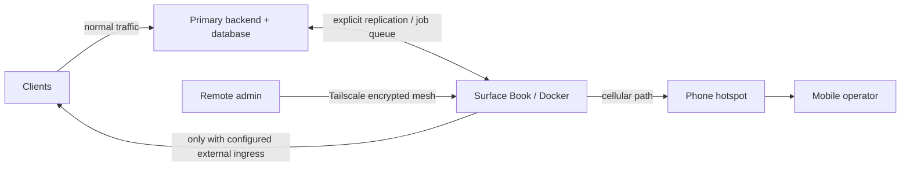

# Architecture — separate network and power dependencies

## Baseline

The primary application stack resides on existing servers and typically reaches the internet through the main fixed-line ISP. The Surface Book is an **additional compute node**. Its intended independent uplink is a phone hotspot using a separate cellular operator/network. Its built-in battery may temporarily keep its own CPU, storage and wireless equipment alive during local AC loss.

## What two internets really provide

- **Fixed-line WAN:** normally attached to the main router and primary infrastructure.
- **Mobile WAN:** independently provided by a smartphone (hotspot via Wi-Fi or USB tethering), subject to carrier coverage, data plan and phone power.
- **Avoid assuming independence:** the primary WAN and mobile network may share upstream infrastructure or experience the same citywide event.
- **Do not rely on automatic failover without testing:** physical Ethernet link-up can coexist with total ISP failure. Route switching needs reachability checks and clear policy.

## Critical dependencies during a blackout

| Element | Without grid power | Requires |
|---|---|---|
| Surface Book | Continues while internal battery is usable | Correct battery state, runtime margin, thermal health |
| Smartphone hotspot | Continues while phone/power-bank has charge | Cellular service and data plan |
| Home Wi-Fi router | Usually turns off | UPS or an alternate network path |
| Main servers | Only if UPS capacity is sufficient | Appropriate UPS/PDU and shutdown policy |
| Public application route | Not automatic | Health checking, ingress and DNS/proxy mechanism |
| Database | Not automatically available | Replication, fencing, recovery and consistency policy |

## Proposed workload placement

**Suitable in principle:** small API replicas whose configuration/state are externalized, queued thumbnail generation, lightweight FFmpeg workers, observability probes, monitoring, scheduled jobs and a verified read-only fallback page. For media workloads, prefer Intel Quick Sync benchmarks over assuming the 1 GB NVIDIA chip accelerates H.264 encoding.

**Unsuitable by default:** an unsynchronized writable primary database, a large live-video processing cluster, high-concurrency AI inference, or any service requiring a guaranteed low-latency public callback without an established ingress method.

## Failover design checklist

1. Define each service's **RTO** (recovery time objective) and **RPO** (recovery point objective).
2. Classify service state: stateless, read-only, cache, replicated database, or authoritative writer.
3. Implement persistent health probes from an observer outside the site.
4. Use a reachable secondary endpoint (e.g. independently powered public proxy/tunnel); a Tailscale IP alone does not make an app public.
5. Establish a safe traffic cutover with read/write fencing to prevent split brain.
6. Configure active/passive worker priority; stop heavy video jobs while running critical failover tasks.
7. Test a simulated main-ISP outage, a power interruption and an application-process crash separately.
8. Document rollback, alerts and logs for each failure mode.

## Failure matrix

| Fault | What survives | What can still fail |
|---|---|---|
| Primary ISP outage | Cellular path may survive | No ingress switch, carrier problems |
| Local AC outage | Surface battery and phone battery may survive | Home router, exhausted cells, thermal shutdown |
| Main host crash | Secondary compute may survive | Database/state replication |
| Hotspot outage | Main ISP may still work | Secondary route unavailable |
| Surface SSD failure | Primary infrastructure unaffected | All secondary services until restore |
| Shared config error | Neither node necessarily survives | Mistakes propagated to both |

**Conclusion:** redundancy is a property of the complete service path, not of the laptop in isolation.
