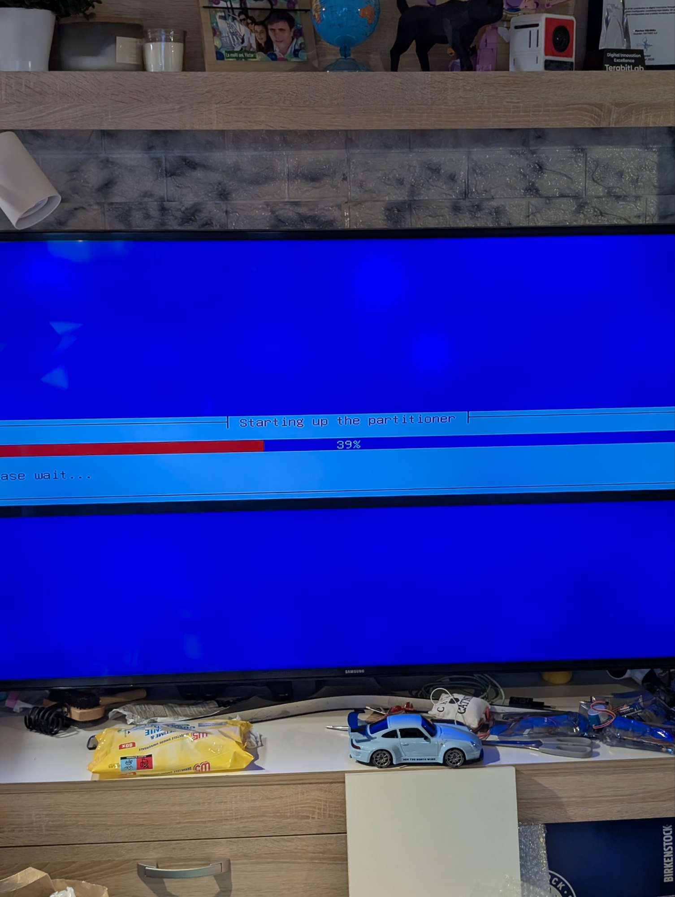

# Field notes: what it actually took to revive the Surface Book

The easiest version of this story is “we installed Linux on an old laptop.” It would also be misleading.

We began with a first-generation Surface Book that was no longer practical to operate through its built-in display. The issue was reported to originate on the mainboard, but we did not diagnose the failed component electrically. What mattered operationally was that the CPU, storage, Wi-Fi and battery system still made it useful for work that did not need a screen.

The reason to keep this machine was not to build another workstation. We already had servers. We needed a *different failure domain*: a small computer that could stay powered when the mains supply failed and, with a phone's hotspot and a suitably configured network path, reach the internet without relying on the main ISP. Running a spare copy of a backend only matters if clients can reach it and the data it uses are consistent. The plan was therefore to begin with a dependable headless node, then add application resilience deliberately.

## Four problems encountered during the first installation

**1. Installing manually was awkward.** The machine used an external television as a temporary screen. Photographing installer dialogs from across the room was slow and error-prone. This motivated a repeatable install USB and SSH administration after the first boot.

**2. EFI bootloader installation failed.** An initial Debian install reached the GRUB stage and failed to install `grub-efi-amd64`; a systemd-boot attempt also failed. Those messages alone do not prove a firmware or Secure Boot defect. A later automated install used an explicit EFI partition and a fallback GRUB path, and the machine successfully booted. The exact original cause was **not established**.

**3. The installer sometimes stopped on a blank blue screen.** We observed a hang near automatic partitioning. Adjusting an installer Preseed option and making storage definitions simpler were among the changes made for the successful workflow. We should not claim that the blue-screen cause was proven without full logs.

<em>Debian partitioner running on the Surface Book, displayed on a Samsung TV used as a temporary monitor during the installation.</em>

**4. The build scripts initially failed on macOS.** We encountered a TLS hostname mismatch on a Debian mirror, a missing `mkfs.fat` path despite Homebrew's `dosfstools` being installed, and a Python `seek of closed file` check in the USB logger validator. The public version includes mirror fallback, tool detection and an updated validation script. These failures are precisely why installers should exit on failed validation rather than confidently reporting success.

## What the successful report supports

On the actual hardware, the OS booted Debian 13 and an SSH connection succeeded. Post-install diagnostics showed a root filesystem spanning almost all of the 256 GB SSD, Docker, Cockpit and SSH running, plus a connected Wi-Fi interface. The Tailscale service was running but the node was not yet enrolled. One internal battery reported about 40.455 Wh full-charge capacity from 51 Wh design. The other internal battery was not visible in the collected Linux report. The Intel GPU was visible; the base should contain an NVIDIA dGPU according to Microsoft's specs, but it was not enumerated by `lspci`.

These are observations, not promises of resilience. A phone hotspot, remote access routing, replication, application traffic failover and battery autonomy are separate, measurable acceptance tests.

## Lessons for the next person

It is tempting to build a “one-click” installer and promise that no one will need to touch a keyboard. We chose a more careful promise: one **locally configured** image, a deliberate destructive boot-menu selection, automatic operating-system installation if network/firmware are compatible, and an SSH-accessible node afterward. Before the target has a working bootloader, there is still no substitute for a recovery plan. Do not place a device with aging lithium batteries upright between fabric and cushions; give it a stable, ventilated surface and test the power path safely.
