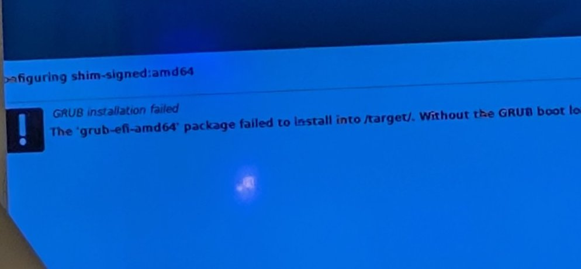

# Troubleshooting — actual issues encountered

This section distinguishes **what was observed**, **what fixed the workflow** and **what has not been proven**.

## Debian install stops with a solid blue screen

The early installation attempt was seen stalled on a largely blank blue installer screen. A preseed partitioning issue was considered, including interaction with a `partman-basicfilesystems/no_swap` answer. A revised preseed was used in later successful runs. Because no complete original syslog was archived, do **not** state that a specific Debian bug was conclusively the cause.

**Actions:** review `SURFACELOG/INSTALLER.LOG` and `PARTMAN.LOG`; compare partition recipe, firmware mode and full disk identity. Prefer the guarded, reviewed installer configuration rather than manually erasing disks again.

## GRUB or systemd-boot installation fails

*Original installer error on the external monitor (cropped photograph).*

The manual netinst attempt showed `grub-efi-amd64` failing within `/target`; a secondary systemd-boot attempt also failed. The automated workflow later used a clean GPT/EFI/ext4 recipe and GRUB's fallback EFI path, without updating NVRAM. This is a **working alternative**, not proof that Secure Boot alone was the issue.

**Actions:** verify `/boot/efi`, EFI partition FAT type, repository access, available packages, firmware mode and logs. Avoid blind GRUB reinstallations or random Secure Boot toggles.

## `curl: (60) SSL: no alternative certificate subject name matches ...`

A particular ISO mirror URL caused a certificate hostname mismatch. The builder was revised to try approved HTTPS mirrors and verify the download's SHA-512 value. **Do not fix this using `curl -k`** or disabling certificate checks.

## `mkfs.fat: command not found` on macOS

Homebrew installed `dosfstools` but placed `mkfs.fat` under a directory such as `/usr/local/sbin`. The revised script adds Homebrew `sbin` directories and resolves the path through `brew --prefix dosfstools`.

## `ValueError: seek of closed file`

The historical Python verifier closed the ISO file before trying to seek again. The v6.1 helper moves reads under an open file handle. This is a build-time verification issue, not a Surface Book kernel failure.

## Cannot see USB log partition

The FAT32 `SURFACELOG` partition is appended to a hybrid ISO layout. Not all operating systems mount every USB partition automatically. Check macOS Disk Utility and don't accept any "Initialize USB" suggestion that would destroy evidence. Logs start only after preseed starts and can lag a hard crash.

## `surfacebook-node.local` not found

mDNS/Avahi is a convenience, not a guaranteed universal resolver. Use the router's DHCP clients list and try SSH to the current LAN address. Do not run SSH from within the same machine to `hostname.local` to test reachability from another host; loopback resolution may mislead.

## Only one battery appears / NVIDIA not visible

Check `/sys/class/power_supply` and `lspci` first. USB HID batteries can belong to accessories. A Surface-specific ACPI controller can be visible even when dGPU is not exposed as PCI. Preserve the functional Debian kernel until a driver modification has a tested rollback procedure.

## Known constraints

- The builder pins Debian 13.7; mirrors serving only later point releases require a **conscious version update**.
- Physical unattended boot cannot be guaranteed across all Surface firmwares or storage variants.
- Fallback UEFI behavior is hardware- and firmware-specific.
- The mobile hotspot and router must themselves remain powered.
